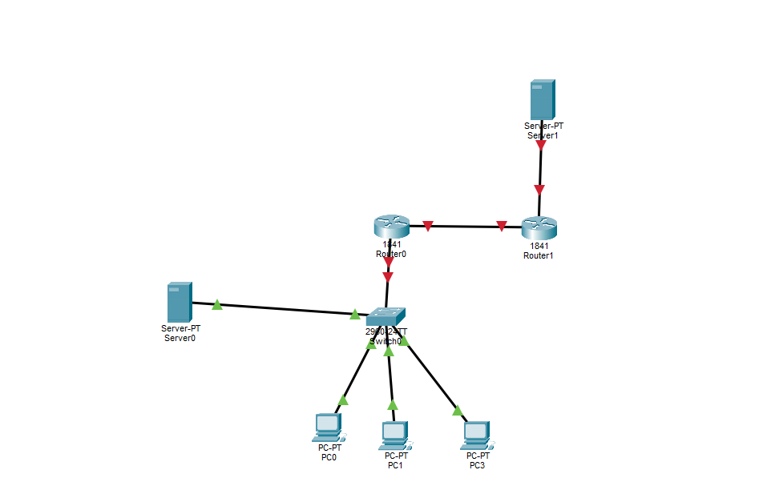

# Лабораторная работа по компьютерным сетям
## Тема Технология трансляции сетевых адресов NAT и PAT в корпоративных сетях

### 1 Теоретические основы технологий трансляции адресов NAT и PAT
* **Проблема дефицита адресов** В архитектуре стека TCP IP количество доступных глобальных IPv4 адресов ограничено Для решения проблемы экономии адресного пространства используются диапазоны частных серых адресов
* **Назначение NAT** Технология Network Address Translation осуществляет динамическое преобразование серых внутренних адресов в белые публичные адреса при выходе пакетов в Интернет
* **Сущность механизма PAT overload** Port Address Translation позволяет сотням компьютеров локальной сети одновременно выходить в Интернет используя всего один единственный публичный IP адрес Идентификация обратных потоков данных при этом происходит по уникальным номерам портов транспортного уровня

### 2 Готовая схема топологии корпоративной сети


### 3 Подтверждение конфигурации оконечных узлов IP адресация


### 4 Конфигурационные команды для коммутатора Switch0
Команды для создания виртуальных локальных сетей VLAN 2 для компьютеров и VLAN 3 для серверов а также распределения физических портов

```text
enable
configure terminal
vlan 2
name COMP
vlan 3
name SERW
exit
interface range fastEthernet 0/1 - 3
switchport mode access
switchport access vlan 2
exit
interface fastEthernet 0/4
switchport mode access
switchport access vlan 3
exit
interface fastEthernet 0/5
switchport mode trunk
exit
```

### 5 Конфигурация домашнего роутера Router0 офиса
Настройка sub интерфейсов для маршрутизации между VLAN активация портов и включение динамической трансляции PAT overload совместно со статическим NAT для проброса веб сервера

```text
enable
configure terminal
interface fastEthernet 0/0
no shutdown
exit
interface fastEthernet 0/0.2
encapsulation dot1Q 2
ip address 192.168.2.1 255.255.255.0
ip nat inside
exit
interface fastEthernet 0/0.3
encapsulation dot1Q 3
ip address 192.168.3.1 255.255.255.0
ip nat inside
exit
interface fastEthernet 0/1
no shutdown
ip address 213.234.10.2 255.255.255.252
ip nat outside
exit
access-list 1 permit 192.168.2.0 0.0.0.255
ip nat inside source list 1 interface fastEthernet 0/1 overload
ip nat inside source static tcp 192.168.3.2 80 213.234.10.2 80
exit
```

### 6 Конфигурация магистрального роутера Router1 провайдера
Настройка внешних интерфейсов имитирующих глобальную сеть Интернет и адресацию внешнего веб сервера

```text
enable
configure terminal
interface fastEthernet 0/0
no shutdown
ip address 213.234.10.1 255.255.255.252
exit
interface fastEthernet 0/1
no shutdown
ip address 200.150.10.1 255.255.255.0
exit
ip route 213.234.10.0 255.255.255.0 fastEthernet 0/0
exit
```
