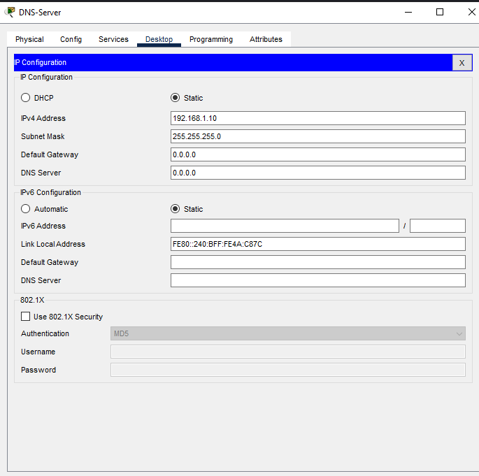
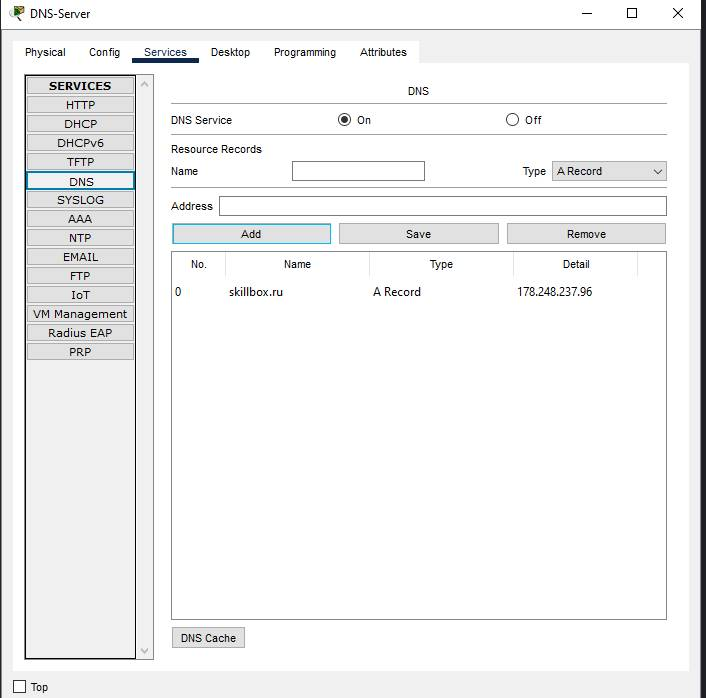
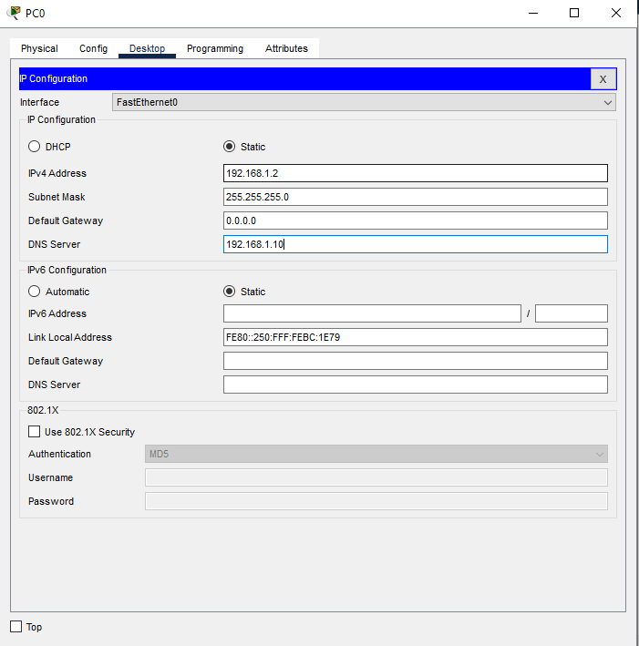

#  Конспект по теме: Система доменных имён (DNS)

---

###  1. Что такое DNS и история создания
* **Как было раньше:** Во времена сети ARPANET данные о сайтах заносились в общую таблицу вручную. Чтобы добавить новый ресурс, нужно было звонить в сетевой информационный центр оператору.
* **Появление автоматизации:** Со временем сайтов стало слишком много, ручное обслуживание стало невозможным, и разработчики создали автоматизированную систему — DNS.
* **Сущность DNS:** Domain Name System — это распределённая система (база данных), которая помогает браузерам автоматически находить IP-адреса сайтов по их понятным текстовым именам.
* **Зачем это нужно:** Весь интернет работает исключительно на системе числовых IP-адресов. Текстовые названия (например, `skillbox.ru`) придуманы только для удобства людей, так как их проще запоминать.

---

###  2. Принцип работы системы и DNS-серверы
* **Аналогия:** DNS работает как обычная телефонная книга. Вместо номеров телефона система сопоставляет имена сайтов с их IP-адресами. Если имени в базе нет, браузер выдает ошибку.
* **DNS-сервер:** Специальный компьютер (или кластер машин), на котором хранятся таблицы привязки IP-адресов к доменным именам. Такие сервера есть у каждого провайдера, VPN-сервиса и крупных IT-компаний.
* **Процесс обработки запроса при вводе сайта:**
  1. Компьютер проверяет локальный файл настроек **`hosts`** (хранит кэш прошлых посещений).
  2. Если адреса там нет, запрос отправляется на локальный DNS-сервер интернет-провайдера.
  3. Локальный сервер опрашивает региональные сервера до тех пор, пока не найдёт нужный IP-адрес.
* **Кэширование:** При получении адреса сервер сохраняет его в память (кэш), чтобы при повторном запросе сайт открывался мгновенно. Кэш обновляется в течение суток, если сайт сменил хостинг.

---

###  3. Практическая настройка DNS в Cisco Packet Tracer

Ниже приведены параметры конфигурации сети для корректного разрешения доменных имён на узлах.

#### Шаг 1. Конфигурация IP-адреса на DNS-сервере
На сервере задается статический IP-адрес, который впоследствии будет указываться на всех клиентских машинах.

#### Шаг 2. Настройка ресурсных записей в службе DNS
Включается служба DNS и создается базовая **A-запись**, связывающая текстовое имя `skillbox.ru` с числовым адресом `178.248.237.96`.

#### Шаг 3. Конфигурация сетевых параметров компьютера PC0
На конечной рабочей станции прописывается статический IP-адрес, а в поле **DNS Server** обязательно вносится адрес нашего настроенного сервера (`192.168.1.10`).

---

###  4. Основные типы записей DNS-сервера
Данные внутри DNS-зоны (логического пространства домена) хранятся в виде специфических ресурсных записей:
* **A** — определяет IPv4-адрес обычного сайта.
* **MX** — указывает адрес почтового сервера домена.
* **CNAME** — используется для создания поддоменов (псевдонимов), указывает на основной домен.
* **NS** — хранит адрес сервера, на котором физически находятся все ресурсные записи.
* **TXT** — любая текстовая информация, относящаяся к конкретному домену.
* **SPF** — список серверов, которым разрешено отправлять почту от имени этого домена.
* **SOA (Start Of Authority)** — начальная, обязательная запись зоны. Содержит базовые сведения: имя первичного сервера, контакты администратора, серийный номер файла зоны для синхронизации кластеров, время кэширования (TTL) и интервалы обновления (Refresh, Retry, Expire).

---

###  5. Устройство и характеристики глобальной системы
* **Корневые серверы:** Всего в мире существует **13 главных (корневых)** DNS-серверов. Для безопасности созданы их полные физические копии — суммарно система включает 123 сервера по всему миру. В России развернуто 5 таких копий (в Москве, Санкт-Петербурге, Ростове-на-Дону, Новой сибирске и Екатеринбурге).
* **Протокол:** DNS относится к прикладному уровню модели OSI. Для защиты данных от подмены адресов злоумышленниками в систему внедрено защитное расширение **DNSSEC**.
* **Главные характеристики системы:**
  * *Распределённость администрирования и хранения* — за разные зоны отвечают разные организации.
  * *Иерархическая (древовидная) структура* — уровни доменов перечисляются справа налево.
  * *Резервирование* — одну зону обслуживают несколько логически и физически разделенных серверов.

---

###  6. Иерархия и уровни доменных имён
Доменное имя разделяется точками на составные части (справа налево):
1. **Домен нулевого уровня (Root domain):** Корневая точка в самом конце (например, `.` в конце `skillbox.ru.`), скрытая от пользователей в браузере.
2. **Домен первого уровня (gTLD / ccTLD):** Доменные зоны. Бывают национальными (`.ru`, `.рф`, `.de`, `.us`) или общими тематическими (`.com` — коммерция, `.org` — некоммерческие, `.info` — информация).
3. **Домен второго уровня:** Основное уникальное имя сайта, придуманное владельцем (например, `skillbox`). Регистрируется через аккредитованные организации ICANN.
4. **Домен третьего уровня (Субдомен):** Используется для логического разделения разделов большого сайта или языковых версий (например, `go` в имени `go.skillbox.ru` или `ru` в `ru.wikipedia.org`).

---
###  Статус: Конспект успешно составлен и оформлен.
