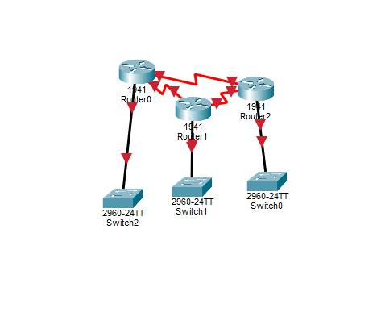

# Конспект по теме: Протоколы динамической маршрутизации (RIP, OSPF, BGP)

---

### 1. Топология исследуемой сети
Ниже представлена схема соединенной корпоративной сети, состоящая из трех маршрутизаторов (Router0, Router1, Router2) и трех коммутаторов, на которой производится настройка и проверка работы протоколов динамической маршрутизации.

<p align="center">
  
</p>

---

### 2. Принципы маршрутизации и структура IP-пакетов
* **Назначение маршрутизации:** Процесс определения оптимального пути для передачи IP-датаграмм от источника к пункту назначения через цепочку промежуточных IP-роутеров.
* **Коммутация на узлах:** При прохождении пакета через роутер, его входящий интерфейс принимает данные, а маршрутизатор на основе таблицы маршрутизации перенаправляет пакет в нужный исходящий интерфейс или PPP-канал.
* **Параметры по умолчанию:** Для корректной работы хостов в локальной сети на них настроен адрес основного шлюза (Default Gateway), указывающий на внутренний интерфейс ближайшего роутера.

---

### 3. Классификация протоколов динамической маршрутизации

Динамические протоколы делятся на два основных класса в зависимости от алгоритма выбора наилучшего пути:

#### Дистанционно-векторные протоколы (Distance Vector)
* **Принцип работы:** Роутеры периодически отправляют копии всей своей таблицы маршрутизации только своим непосредственным соседям.
* **Выбор пути:** Маршрут выбирается на основе расстояния (количества хопов/роутеров до цели).
* **Протоколы:** 
  * **RIP (Routing Information Protocol):** Базовый дистанционно-векторный протокол. Использует метрику количества шагов (максимум 15 хопов) и работает на порту 520/UDP.
  * **IGRP (Interior Gateway Routing Protocol):** Фирменный протокол Cisco, использующий сложную метрику на основе пропускной способности и задержки канала.

#### Протоколы состояния каналов (Link State)
* **Принцип работы:** Роутеры собирают информацию о состоянии всех связей в сети (линк-стейт) и строят полную карту всей топологии.
* **Выбор пути:** Каждый роутер самостоятельно просчитывает кратчайший путь, учитывая реальную скорость каналов, а не просто количество устройств на пути.
* **Пример разницы:** Для Distance Vector путь через медленный ISDN-канал (128kb) может казаться лучше, если там меньше роутеров, в то время как Link State выберет быстрый путь через 100Mb каналы.

---

### 4. Протокол OSPF (Open Shortest Path First)
* **Сущность протокола:** Современный и наиболее популярный протокол маршрутизации внутри корпоративных сетей (IGP), работающий на основе технологии состояния каналов и использующий идентификатор протокола 89/UDP.
* **Иерархическая структура (Areas):** Для снижения нагрузки на процессоры роутеров и уменьшения служебного трафика сеть OSPF разделяется на логические области (Area 1, Area 2, Area 3).
* **Магистраль:** Все области обязаны физически или логически подключаться к главной центральной области — Area 0 (Backbone).

---

### 5. Протокол BGP (Border Gateway Protocol)
* **Масштаб применения:** Протокол внешнего взаимодействия (EGP), работающий по порту 179/TCP. Если RIP, IGRP и OSPF работают внутри автономных систем компаний, то BGP связывает эти огромные сети между собой.
* **Глобальная сеть:** Именно на протоколе BGP держится весь современный глобальный интернет, объединяя провайдеров, магистральные каналы и дата-центры по всему миру.

---

### 6. Практический вывод таблиц маршрутизации (Cisco CLI)

Ниже представлены реальные таблицы маршрутизации, полученные из интерфейса командной строки роутеров при различных конфигурациях сети.

#### Конфигурация статического маршрута по умолчанию (Default Route)
При такой настройке роутер пересылает все неизвестные пакеты на шлюз последней надежды (Gateway of last resort). В таблице этот маршрут помечается символами S*.

```text
Router# show ip route
Codes: C - connected, S - static, I - IGRP, R - RIP, M - mobile, B - BGP
       D - EIGRP, EX - EIGRP external, O - OSPF, IA - OSPF inter area
       * - candidate default

Gateway of last resort is 10.0.0.2 to network 0.0.0.0

     10.0.0.0/24 is subnetted, 1 subnets
C       10.0.0.0 is directly connected, FastEthernet0/0
C       192.168.0.0/24 is directly connected, FastEthernet0/1
S*      0.0.0.0/0 [1/0] via 10.0.0.2
```

#### Конфигурация динамического протокола RIP
При активации RIP маршруты к удаленным подсетям автоматически определяются через соседние роутеры и помечаются в таблице символом R. Метрика [120/1] указывает на административное расстояние RIP (120) и 1 хоп до цели.

```text
Router# show ip route
Gateway of last resort is not set

     10.0.0.0/24 is subnetted, 1 subnets
C       10.0.0.0 is directly connected, FastEthernet0/1
C       192.168.1.0/24 is directly connected, FastEthernet0/0
R       192.168.2.0/24 [120/1] via 10.0.0.2, 00:00:21, FastEthernet0/1
R       192.168.3.0/24 [120/1] via 10.0.0.3, 00:00:01, FastEthernet0/1
                       [120/16] via 10.0.0.4, 00:00:05, FastEthernet0/1
R       192.168.5.0/24 [120/1] via 10.0.0.5, 00:00:25, FastEthernet0/1
```

#### Конфигурация динамического протокола OSPF
При переключении сети на OSPF таблицы перестраиваются быстрее, учитывая состояние каналов. Такие маршруты помечаются символом O, а их административное расстояние по умолчанию равно 110.

```text
Router# show ip route
Gateway of last resort is not set

     10.0.0.0/24 is subnetted, 1 subnets
C       10.0.0.0 is directly connected, FastEthernet0/1
C       192.168.1.0/24 is directly connected, FastEthernet0/0
O       192.168.2.0/24 [110/2] via 10.0.0.2, 00:18:33, FastEthernet0/1
O       192.168.3.0/24 [110/2] via 10.0.0.4, 00:05:06, FastEthernet0/1
                       [110/2] via 10.0.0.3, 00:05:06, FastEthernet0/1
O       192.168.5.0/24 [110/2] via 10.0.0.5, 00:12:03, FastEthernet0/1
```

---
### Статус: Полный конспект лекции и практической части успешно составлен.
