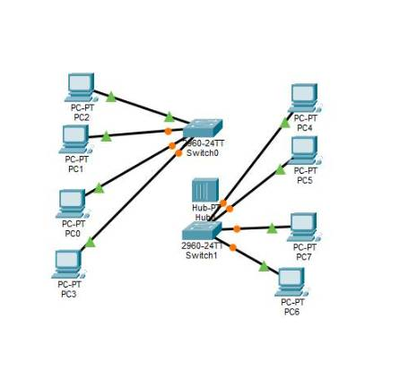
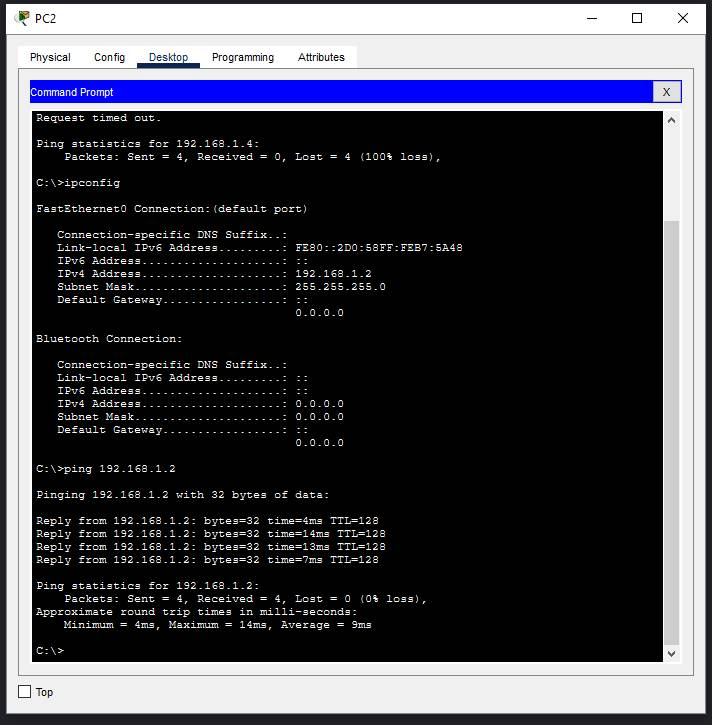
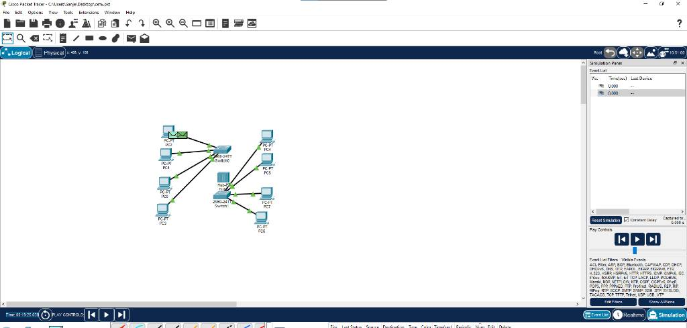

# Отчет по лабораторной работе: Построение локальной сети в Cisco Packet Tracer

---

### 1. Требования к выполнению работы
По условиям задания требовалось спроектировать и настроить локальную сеть в симуляторе Cisco Packet Tracer, включающую в себя следующие аппаратные компоненты:
* 8 персональных компьютеров (рабочих станций);
* 2 сетевых коммутатора (Switch);
* 1 сетевой концентратор (Hub).

В качестве подтверждения успешного выполнения работы в репозитории размещены три графических снимка экрана, демонстрирующих топологию, проверку связности и работу симулятора.

---

### 2. Описание топологии и конфигурация адресного пространства
В процессе выполнения работы была построена и успешно протестирована сетевая модель со следующими параметрами:
* **Именование узлов:** Имена персональных компьютеров (от PC0 до PC7) приведены в соответствие с назначенными им сетевыми адресами для упрощения идентификации в топологии.
* **Адресация:** На рабочих станциях настроена статическая IP-адресация в диапазоне от 192.168.0.2/24 до 192.168.0.9/24.
* **Сетевые соединения:** К сетевому концентратору (Hub) подключено 3 компьютера. К первому коммутатору (Switch0) подключен данный концентратор, а также еще 2 компьютера. Коммутаторы Switch0 и Switch1 соединены между собой через высокоскоростные гигабитные порты (GigabitEthernet). К второму коммутатору (Switch1) подключены оставшиеся 3 компьютера.

  

---

### 3. Подтверждение конфигурации и проверка связности (Ping)
Для проверки корректности настройки сетевых интерфейсов и доступности узлов на рабочей станции PC2 была вызвана командная строка (Command Prompt). Успешный обмен ICMP-пакетами с узлом 192.168.0.2 подтверждает полную связность внутри созданного сегмента сети. Потери пакетов составляют 0%.

  

---

### 4. Работа симулятора в режиме отправки пакетов (Simulation)
Встроенный режим симуляции (Simulation Mode) в Cisco Packet Tracer наглядно демонстрирует процесс прохождения трафика и широковещательной рассылки пакетов через концентратор и коммутаторы к конечным узлам.

  

---
### Статус: Работа выполнена успешно, сеть построена и протестирована.
