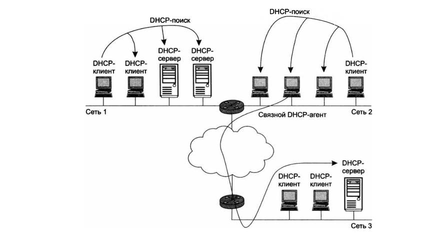

# Тема: Протокол динамического конфигурирования хостов DHCP и механизмы автоматизации сетевых настроек

---

## 1 Проблематика конфигурирования сетевых интерфейсов в стеке TCP IP

* **Сущность сетевой адресации:** Для обеспечения нормального и корректного функционирования любой компьютерной сети каждому активному сетевому интерфейсу конечного компьютера или промежуточного маршрутизатора в обязательном порядке должен быть назначен уникальный IP адрес. Процедура присвоения данных адресов происходит непосредственно в ходе первоначального или последующего конфигурирования узлов.
* **Проблемы ручной настройки:** Назначение IP адресов может осуществляться администратором вручную в результате выполнения стандартной процедуры конфигурирования интерфейса. Для обычного компьютера этот процесс сводится к ручному заполнению системы экранных форм системных настроек. При таком подходе сетевой администратор вынужден постоянно помнить или фиксировать в сторонних базах какие именно адреса из имеющегося множества он уже использовал для других интерфейсов а какие еще остаются свободными.
* **Комплекс конфигурационных параметров:** При ручном или автоматическом конфигурировании помимо самого IP адреса сетевого интерфейса и соответствующей ему маски подсети устройству необходимо сообщить целый ряд других важных параметров. Для эффективной работы стека TCP IP администратор должен назначить клиенту маску подсети IP адрес основного маршрутизатора предлагаемого по умолчанию IP адрес DNS сервера доменное имя компьютера и другие опции. Даже при очень небольшом размере локальной сети эта рутинная работа представляет для человека крайне утомительную процедуру.
* **Решение автоматизации:** Современный протокол динамического конфигурирования хостов Dynamic Host Configuration Protocol DHCP полностью автоматизирует процесс настройки сетевых интерфейсов. При этом он на сто процентов гарантирует защиту от возникновения дублирования IP адресов за счет централизованного управления их распределением из единой базы данных.

---

## 2 Эволюционное развитие протоколов автоматической адресации RARP и BOOTP

* **Протокол RARP:** Reverse Address Resolution Protocol. Одна из первых простейших реализаций для автоматической выдачи IP адресов появилась более 30 лет назад. Принцип его работы заключался в том что клиент при старте отправлял запрос на широковещательный адрес сети RARP сервер принимал его находил в своей локальной базе данных жесткую привязку физического MAC адреса клиента к конкретному IP адресу и отправлял этот IP адрес обратно клиенту в индивидуальном пакете.

  

<i>Рисунок 1. Механизм работы протокола RARP: отправка широковещательного запроса RARP Broadcast и получение определенного IP-адреса от RARP-сервера.</i>

* **Минусы RARP:** Система имела критические недостатки. Во первых администратору приходилось настраивать и содержать RARP сервер в каждом отдельном сегменте локальной сети так как широковещательные пакеты не проходят через маршрутизаторы. Во вторых требовалось заранее вручную регистрировать все MAC адреса на сервере. В третьих протокол физически не имел возможности передавать клиенту дополнительную конфигурационную информацию маски шлюзы DNS.
* **Протокол BOOTP:** Bootstrap Protocol. Был создан на смену RARP и изначально применялся для конфигурирования бездисковых рабочих станций. Этим станциям для загрузки операционной системы по сети требовалось не только выдать IP адрес но и передать дополнительную системную информацию адрес TFTP сервера и точное имя файла загрузки.
* **Механизм Relay в BOOTP:** В отличие от своего прародителя протокол BOOTP получил полноценную поддержку технологии Relay. Связные DHCP агенты или реле агенты представляют собой небольшие фоновые сервисы на маршрутизаторах которые перехватывают широковещательные запросы клиентов и пересылают их направленным пакетом главному серверу находящемуся в другой сети. Это сделало возможным использование всего одного центрального сервера на несколько изолированных подсетей одновременно. Однако в BOOTP оставалась необходимость жесткой ручной настройки таблиц соответствия адресов на сервере и существовало строгое ограничение по размеру для передачи дополнительной информации.
* **Появление DHCP:** Как результат эволюции на сцену вышел современный протокол DHCP. Он является полностью совместимым расширением протокола BOOTP. Это означает что современный DHCP сервер без проблем поддерживает и обслуживает устаревших BOOTP клиентов но устаревший сервер не способен работать с DHCP клиентами.

---

## 3 Детальный разбор режимов работы DHCP сервера

Протокол DHCP строго функционирует в соответствии со стандартной моделью клиент сервер. Во время старта операционной системы компьютер являющийся клиентом отправляет в сеть широковещательный запрос. Сервер откликается и посылает ответ содержащий параметры. В зависимости от настроек администратора сервер может работать в трех принципиально разных режимах:

* **Ручное назначение статических адресов:** В данном режиме администратор помимо пула доступных адресов снабжает DHCP сервер информацией о жестком соответствии конкретных IP адресов физическим MAC адресам или другим идентификаторам клиентских узлов. Сервер пользуясь этой таблицей всегда выдает определенному клиенту один и тот же закрепленный за ним адрес и фиксированный набор параметров.
* **Автоматическое назначение статических адресов:** DHCP сервер самостоятельно без прямого вмешательства человека произвольным образом выбирает клиенту свободный IP адрес из доступного пула адресов. Этот адрес выдается клиенту в постоянное бессрочное пользование. Соответствие устанавливается автоматически в момент самого первого обращения клиента к серверу. При всех последующих перезагрузках или запросах сервер всегда возвращает этому клиенту тот же самый первоначально выделенный IP адрес.
* **Динамическое распределение адресов:** В этом режиме сервер выдает IP адрес клиенту на строго ограниченное время которое называется сроком аренды lease time. Когда компьютер отключается от сети или удаляется из подсети назначенный ему IP адрес автоматически освобождается сервером по истечении срока аренды. Когда этот же компьютер подключается к другой подсети ему автоматически назначается совершенно новый адрес из пула этой подсети. Ни пользователь ни сетевой администратор вообще не вмешиваются в данный процесс.

---

## 4 Преимущества динамического распределения и алгоритм экономии пула адресов

* **Экономия адресного пространства:** Помимо автоматизации рутины динамический режим позволяет строить рабочую IP сеть количество физических узлов в которой значительно превышает количество имеющихся в распоряжении администратора легальных IP адресов.
* **Пример с мобильными сотрудниками:** Если в организации 500 сотрудников имеют ноутбуки но из за командировок и работы на дому в офисе одновременно присутствуют не более 50 человек то получать у провайдера 500 адресов нерационально. Администратору достаточно настроить DHCP сервер на пул из 64 адресов и оборудовать в офисе 64 физических рабочих места. Каждый приходящий сотрудник включает ноутбук его DHCP клиент запрашивает параметры и временно занимает один из 64 адресов. После его ухода адрес освобождается. Таким образом для работы 500 мобильных сотрудников достаточно иметь в наличии всего 64 IP адреса.
* **Срок аренды и параметры управления:** Администратор полностью контролирует процесс конфигурирования сети определяя два главных параметра пула доступных адресов и срок аренды. Длительность аренды диктуется режимом работы сети. Для учебных заведений куда студенты приходят со своими ноутбуками только на пары срок аренды может быть равен длительности одной лабораторной работы. В стабильных корпоративных сетях где сотрудники работают на регулярной основе срок аренды выбирается более продолжительным.

---

## 5 Архитектура обмена сообщениями и шестиэтапный алгоритм DHCP

Для надежности в крупных сетях часто устанавливают резервный DHCP сервер на случай отказа основного. Процесс обмена пакетами между клиентом и сервером выглядит следующим образом:

1. **DHCP поиск DISCOVER:** При включении компьютера установленный на нем DHCP клиент формирует и посылает в локальную сеть ограниченное широковещательное сообщение пакета поиска. Данный пакет имеет IP адрес назначения из одних единиц 255.255.255.255 и доставляется абсолютно всем узлам в текущем сегменте.
2. **Перехват связным агентом Relay:** Все находящиеся в сети DHCP серверы принимают данный пакет. Если в локальном сегменте сервера нет широковещательный пакет перехватывает связной DHCP агент и направленным пакетом пересылает его удаленному DHCP серверу в другую сеть адрес которого агенту известен заранее.

  

<i>Рисунок 2. Архитектура сети с реле-агентом (Связным DHCP-агентом), пересылающим широковещательные запросы DHCP-поиск из Сети 1 и Сети 2 к серверам.</i>

3. **DHCP предложение OFFER:** Все серверы получившие пакет поиска анализируют свои пулы и отправляют клиенту свои индивидуальные DHCP предложения. Каждое такое предложение содержит свободный IP адрес маску и другие параметры. Если сервер удаленный он шлет ответ обратно через реле агента.

4. **DHCP запрос REQUEST:** Клиент собирает конфигурационные предложения от всех серверов. Как правило он выбирает самое первое из поступивших предложений и отправляет в сеть повторный широковещательный DHCP запрос. В этом пакете клиент открыто указывает идентификатор того сервера предложение которого он принял а также значения принятых параметров. Это нужно для того чтобы остальные серверы поняли что их предложения отклонены аннулировали их и вернули зарезервированные адреса обратно в свои пулы.
5. **DHCP квитанция ACK:** Все серверы получают этот запрос но только один выбранный сервер отправляет клиенту положительную DHCP квитанцию подтверждающую закрепление IP адреса и финальные параметры аренды.
6. **Переход в рабочее состояние:** Клиент успешно принимает положительную квитанцию фиксирует все настройки в стеке TCP IP и переходит в полноценное рабочее состояние в сети.

---

### 6 Механизмы обновления аренды и системные проблемы динамического пула

Процедура обновления аренды. Время от времени в процессе работы компьютер пытается обновить параметры своей аренды. Первую попытку он делает задолго до окончания срока аренды направляя индивидуальный запрос тому серверу от которого получил текущие настройки. Если сервер молчит клиент через время повторяет запрос. Если попытки безуспешны клиент отправляет широковещательный запрос к другим серверам. В случае полного отказа или получения отрицательной квитанции клиент полностью теряет сетевые параметры и переходит в режим изолированной автономной работы. Также клиент может досрочно отказаться от адреса по своей инициативе при выключении ПК.

Проблема преобразования имен DNS. Непостоянство динамических IP адресов создает серьезные проблемы для службы DNS. Трудно поддерживать таблицы соответствия доменных имен IP адресам если адреса меняются каждые несколько часов. Для решения этой проблемы была создана Динамическая автоматическое согласование адресных баз служб DHCP и DNS в режиме реального времени.

Исключения из динамического распределения. Существуют типы устройств для которых динамическое назначение адресов категорически запрещено. Постоянные статические IP адреса в обязательном порядке назначают маршрутизаторам серверам сетевым принтерам и устройствам местоположение которых физически и логически не меняется. До них проще получить доступ зная постоянный адрес.

Проблемы мониторинга и безопасности. Использование динамических адресов сильно усложняет удаленное управление автоматический мониторинг сбора статистики и фильтрацию пакетов на брандмауэрах безопасности так как фильтровать пакеты по постоянно меняющимся полям IP адресов невозможно. Для таких интерфейсов администраторы всегда используют только ручное статическое закрепление адресов.

---
### Статус: Конспект лекции успешно составлен и структурирован.
